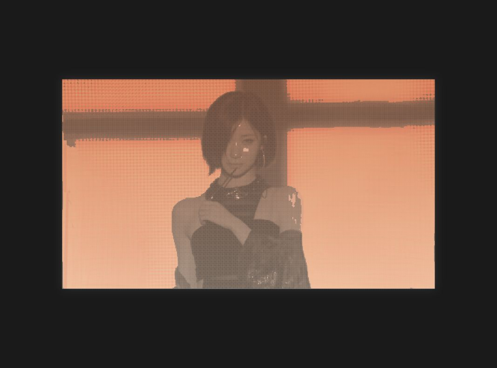

# ASA Code Portrait

From ASCII to Particle Animation: Generating ASA's Code Portrait with p5.js

## Why This Moment

I want to help ASA remember forever this performance—her concert in her hometown of Japan in September 2026.

Yumeji Takehisa wrote in *Mono no Aware*:

> To call it tears would be too heavy; to call it joy would be too strong. It was just, how should I put it, an indescribable, strangely wonderful feeling.

What I want to preserve is exactly this moment.

## Why Characters and Particles

Character art is the genesis of text—the image is deconstructed into its most basic textual units, suggesting that language and code are the underlying logic that constructs reality. Slovenian artist Vuk Ćosić said: "Coding itself is a form of writing, and it inevitably carries ideology."

Particle animation is the eternal aggregation and dissolution—the image is broken down into countless points that follow the laws of physics, collapsing and reassembling, precisely simulating the cycle of entropy increase and order reconstruction in nature. While many pursue high-tech simulations of perfect 3D photorealistic images, this piece is instead a refusal: away from the brush, away from the paint bucket, using the simplest non-image units to construct a complex visual world.

## From Characters to Particles: A Visual Approximation

This is not a technical upgrade, but a continuous approach toward the feeling of that moment:

| Version  | Technique             | Problem at the Time                                             | Effect                                     |
| -------- | --------------------- | --------------------------------------------------------------- | ------------------------------------------ |
| **v0.1** | ASCII Art             | The coarseness of characters obscured the fragility on her face | Facial features blurred                    |
| **v0.2** | Halftone 100px        | Switched to dots, but the background was too dense              | The figure didn't stand out                |
| **v0.3** | Halftone 300px        | Increased density, overall clearer but the face was still soft  | Not enough detail                          |
| **v0.4** | Adaptive Grid         | Face 500 / Background 150, but edges had discontinuities        | Face clear, transitions harsh              |
| **v0.5** | Single-layer Dissolve | Feathered transitions, background disappeared                   | ASA emerged                                |
| **v1.0** | Static High-res       | 500 resolution                                                  | Perfect print effect                       |
| **v2.0** | Particle System       | 44,000 particles aggregating in real time                       | Dynamic generation + high-res freeze-frame |

## Technical Implementation

**Pixel Sampling and Mapping**

- `img.get(x, y)` extracts pixel brightness, mapped to dot size
- Higher brightness = larger dots; lower brightness = smaller dots or empty space

**Adaptive Resolution**

- Figure area: 500 density, preserving facial details
- Background area: 150 density, creating visual hierarchy
- Edge feathering: smooth transitions, eliminating discontinuities

**Particle System and Performance**

- 44,000 particles aggregating in real time, 60 FPS
- Pixel buffer rendering (`loadPixels`/`updatePixels`), avoiding per-point drawing overhead
- After aggregation completes, switches to a 500-resolution static cache layer for a high-res freeze-frame

## Running

1. Clone the repository
2. Open `index.html` with a local server (e.g., VS Code Live Server)
3. Click the canvas: particles aggregate → high-res freeze-frame
4. Press `S` to save the current frame

## File Description

- `sketch.js` — Final version (particles + high-res freeze-frame)
- `versions/` — Historical iteration code, can be run individually to view effects

## Preview

## License

MIT

*Fan art for personal use only. Original photo credit to owner.*
